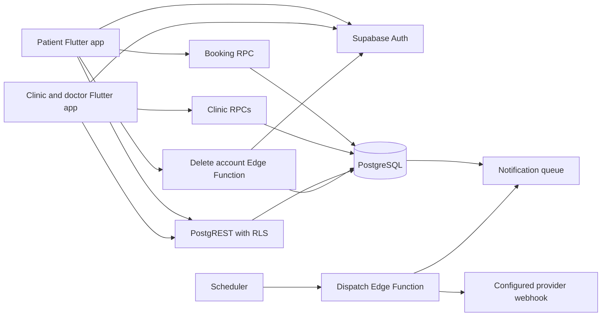

# CareConnect architecture

Availability is derived on demand from weekly schedules in each clinic's IANA time zone. `available_slots` iterates real instants, so repeated local hours are distinct and nonexistent local times are skipped. The booking RPC rechecks the slot inside PostgreSQL. GiST exclusion constraints on the doctor and patient intervals close the race between concurrent requests. The app never carries a service role key.

Patient-facing appointment data is available only to the patient, the linked doctor, clinic admins, and platform admins through RLS. Administrative writes use narrowly scoped security-definer RPCs. Notification rows are durable; the scheduler claims due rows with `FOR UPDATE SKIP LOCKED`, retries provider failures, and sends generic preview text only.

For large clinics, replace the minute-level availability function and per-request analytics with indexed or materialized availability partitions after load testing. The current version favors clear, correct slot semantics over high-volume optimization.
